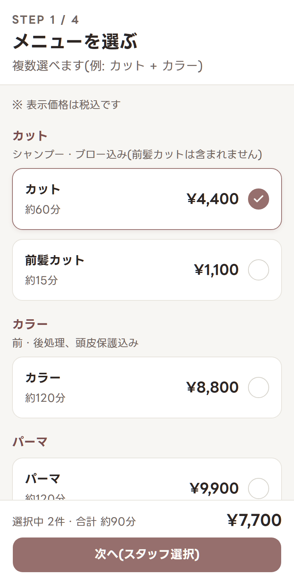
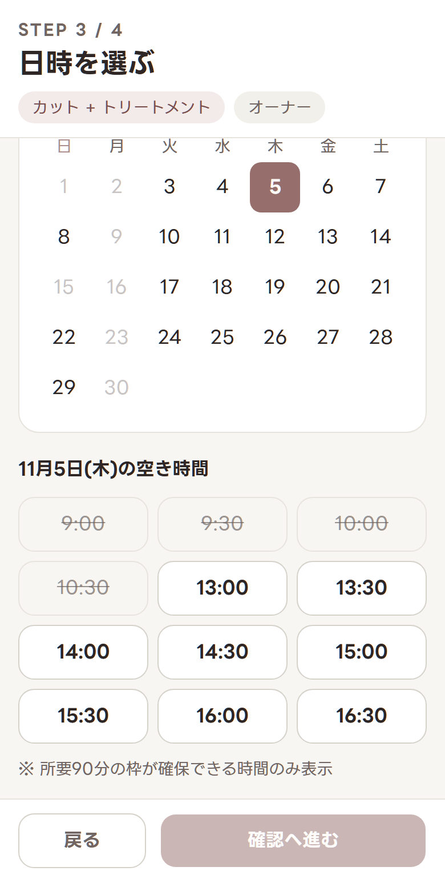
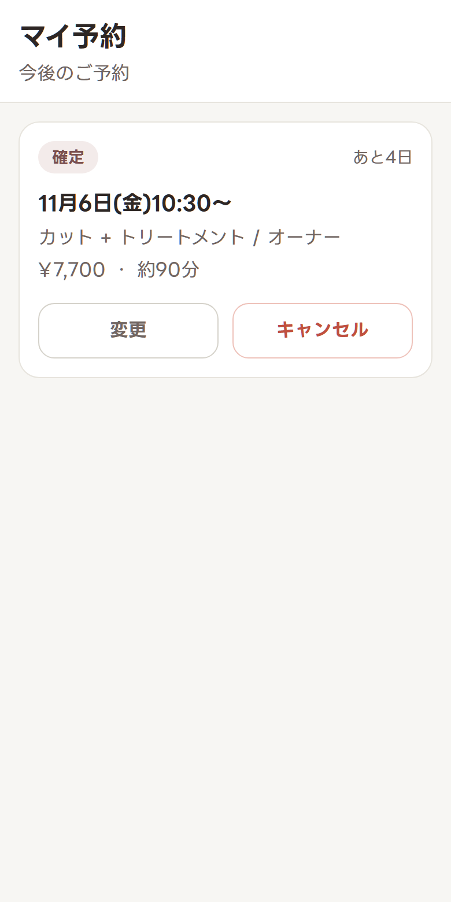
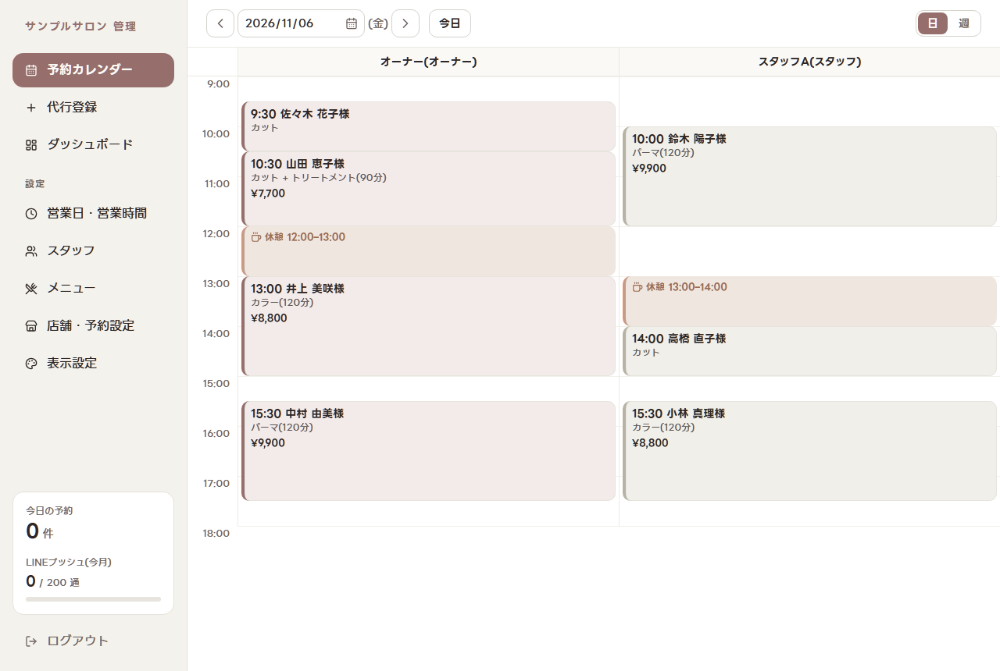
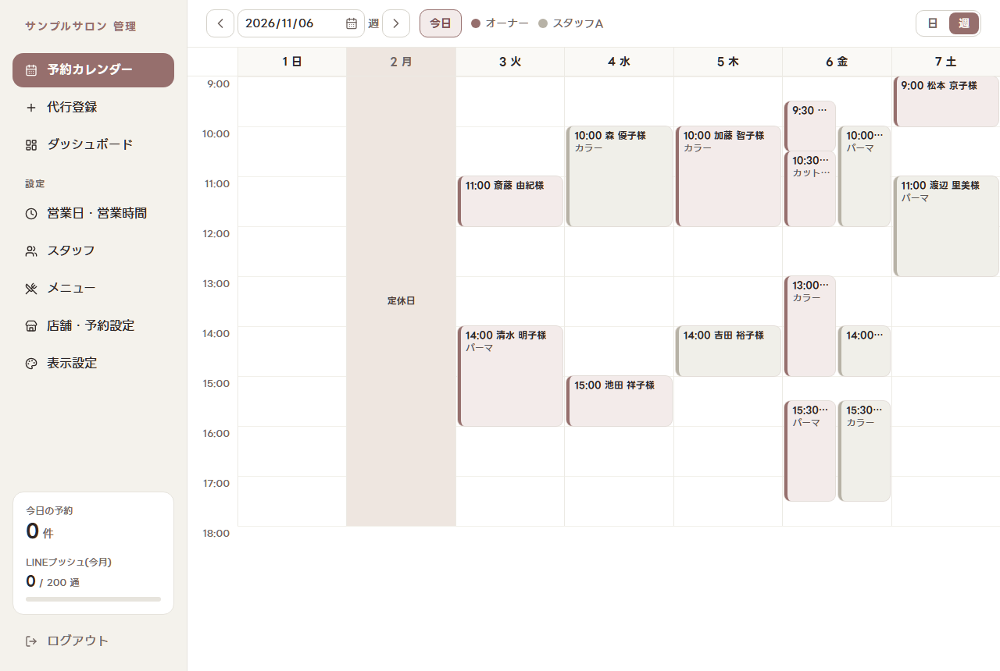
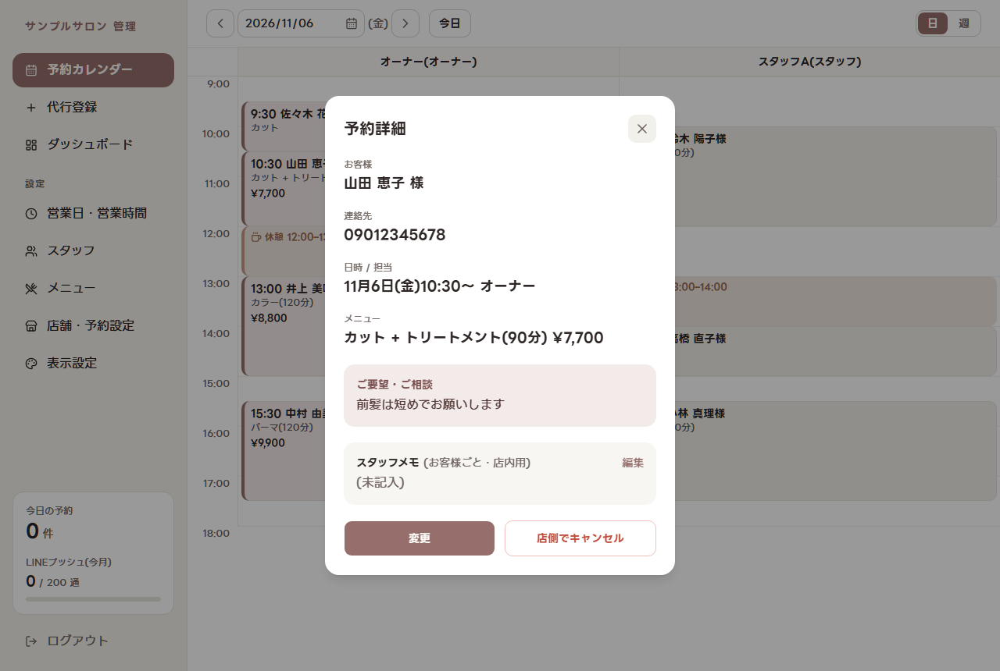

# salon-booking-liff

美容室の来店予約システム。客は LINE 公式アカウントから予約し(LIFF)、店は Web の管理画面で予約を管理する。手帳と LINE のやり取りで起きていたダブルブッキングをなくすために作った。

> **状態:** 実際の美容室の要件をもとに作り、テスト用の LINE 公式アカウントで動作を確認したが、店舗では運用していない(理由は「[店で運用しなかった理由](#店で運用しなかった理由)」)。保守の予定はなく、参考実装として公開している。

> このリポジトリのモック、テスト、コメント、コミットメッセージに出てくる店名(LUCE)、スタッフ名(田中・佐藤)、メニュー、料金は架空のものです。実在の店舗・人物とは関係ありません。

## 画面

スクリーンショットは手元の環境とダミーデータで撮影したもの。

操作の手順は **[操作マニュアル](https://chikaraction.github.io/salon-booking-liff/)**(GitHub Pages)にまとめている。

| メニュー選択                                        | 日時選択                                            | マイ予約                                                   |
| --------------------------------------------------- | --------------------------------------------------- | ---------------------------------------------------------- |
|  |  |  |

| 予約カレンダー(日表示)                                                       |
| ---------------------------------------------------------------------------- |
|  |

| 予約カレンダー(週表示)                              | 予約詳細                                                   |
| --------------------------------------------------- | ---------------------------------------------------------- |
|  |  |

## できること

**客側(LINE から開く LIFF アプリ)**

- メニューの複数選択、スタッフの指名(「どちらでも」も可)
- 所要時間分の枠を確保できる開始時刻だけを選べる空き枠の表示
- 予約の確定・変更・キャンセル(マイ予約)

**店側(Web の管理画面)**

- 予約カレンダー(日・週)と、電話予約の代行登録
- 営業日(定休日、第 n 週の定休、祝日、臨時休業)、スタッフの勤務パターン、メニューの管理
- オーナーとスタッフの権限の分離
- 予約の集計と LINE の送信数のダッシュボード

**通知(LINE)**

- 予約確認の応答と前日リマインド

## 設計のポイント

判断の理由と検討した代替案は [ADR](docs/adr/) にある。

- **ダブルブッキングはデータベースで防ぐ**([ADR-004](docs/adr/ADR-004-double-booking.md)): PostgreSQL の EXCLUDE 制約で、同じスタッフの時間帯の重なりを拒否する。空きを確認してから保存するだけでは、同時に押された予約を防げないため。
- **LINE の無料枠に収める**([ADR-002](docs/adr/ADR-002-notification.md)): 無料の応答メッセージを優先して使い、無料枠を消費するプッシュは前日リマインドだけにする。送信数が 150 通を超えると管理画面で警告する。
- **マルチテナントにしない**([ADR-007](docs/adr/ADR-007-single-tenant.md)): 店舗ごとに環境を 1 セット用意する。店名やメニューなどの店舗固有の値はコードに書かず、管理画面から設定する。
- **権限はアプリと RLS の二重で守る**([ADR-005](docs/adr/ADR-005-admin.md)): 画面の出し分けとは別に、データベースの行レベルセキュリティでも拒否する。
- **判断ロジックを純粋関数に分ける**: 予約枠の計算、営業時間の判定、通知の文面などを `src/lib/` に置き、UI と Server Action は配線に徹する。

## テスト

| 種類                                                        | 内容                                                                                                                                                    |
| ----------------------------------------------------------- | ------------------------------------------------------------------------------------------------------------------------------------------------------- |
| ユニットテスト(Vitest)                                      | `src/lib/` の純粋ロジック。911 件                                                                                                                       |
| E2E(Playwright。[ADR-008](docs/adr/ADR-008-e2e-testing.md)) | 同時予約での競合、アクセス制御、予約の流れ、設定の反映、画面幅の崩れなど。Chromium、WebKit、Firefox で計 121 件(同じテストをブラウザごとに流す分を含む) |
| 手作業の確認                                                | LINE の実機や通知など、自動テストで確かめられない項目は [チェックリスト](.claude/skills/verify-booking/SKILL.md) で確認する                             |

PR と `main` への push では、GitHub Actions の CI が Lint・ユニットテスト・型チェック+ビルドを回し([`.github/workflows/ci.yml`](.github/workflows/ci.yml))、CodeQL がコードの脆弱性を調べる([`.github/workflows/codeql.yml`](.github/workflows/codeql.yml))。どちらも通らないと `main` にマージできない。E2E は手元の Supabase が要るので CI では回さず、手元で流す。

## 店で運用しなかった理由

オーナーに実際に見てもらった結果、次の理由で店では使わないことになった。

- 料金と所要時間が固定ではなく人によって幅があり、オーナーが客とのやり取りで調整している
- スタッフは毎週決まった日に出勤するのではなく、1 人で無理な予約のときにスポットで入る

このシステムは、料金と所要時間をメニューごとに固定し、スタッフの勤務を曜日ごとの決まったパターンで登録する前提で作っている。週や月ごとにシフトを組む機能はない。そのため、次のような店に向いている。

| 向いている店                         | 向いていない店                                                 |
| ------------------------------------ | -------------------------------------------------------------- |
| メニューごとに料金と所要時間が決まる | 客ごとに相談して料金や時間を決める                             |
| 勤務日が決まっている従業員がいる     | アルバイトのシフトを週や月ごとに組む、必要なときだけ来てもらう |
| 客と LINE 公式アカウントでつながる   | LINE を使わない客が多い                                        |

## 開発の進め方

[Claude Code](https://claude.com/claude-code) を使い、AI が実装の大部分を書いている。多くのコミットに `Co-Authored-By: Claude` が付いているのはそのため。

- **自分の担当:** オーナーへのヒアリングと要件の整理、モックの確認、設計判断の承認、実機での確認、デプロイと外部サービスの設定
- **AI の担当:** ADR と計画書の下書き、実装、テスト、レビュー

AI の出力がぶれないよう、次の仕組みをリポジトリに置いている。

- [`CLAUDE.md`](CLAUDE.md): 設計規約と、ADR に矛盾する実装は相談するというルール
- [`.claude/skills/`](.claude/skills/): 機能を実装するときの手順と、マージ前の確認項目
- [`.claude/hooks/`](.claude/hooks/): 変更したファイルの Lint と、実装をサブエージェントに任せるための制限

## スタック

| 領域           | 使っているもの                               | 選定理由                                                                                  |
| -------------- | -------------------------------------------- | ----------------------------------------------------------------------------------------- |
| フロントエンド | Next.js 16(App Router)、React 19、TypeScript | [ADR-001](docs/adr/ADR-001-tech-stack.md)                                                 |
| UI             | Tailwind CSS v4、shadcn/ui                   | [ADR-006](docs/adr/ADR-006-design-system.md)                                              |
| データベース   | Supabase(PostgreSQL、Auth)                   | [ADR-001](docs/adr/ADR-001-tech-stack.md)                                                 |
| ホスティング   | Cloudflare Workers(OpenNext)                 | [docs/milestone-6-plan.md](docs/milestone-6-plan.md)                                      |
| LINE           | LIFF、Messaging API                          | [ADR-002](docs/adr/ADR-002-notification.md)、[ADR-003](docs/adr/ADR-003-customer-auth.md) |
| テスト         | Vitest、Playwright                           | [ADR-008](docs/adr/ADR-008-e2e-testing.md)                                                |

## 手元で動かす

Node.js(`.node-version` のバージョン)と Docker が必要。LINE のアカウントがなくても、LIFF のスタブで客側の画面を動かせる。

```sh
npm install
npx supabase start            # 手元の Supabase を起動する(Docker を先に起動しておく)
npx supabase db reset --local # マイグレーションとダミーデータを入れる
cp .env.example .env.local
```

`.env.local` に次の値を入れる。Supabase の値は `npx supabase status -o env` で確認できる。

```sh
NEXT_PUBLIC_SUPABASE_URL=      # API_URL の値
NEXT_PUBLIC_SUPABASE_ANON_KEY= # ANON_KEY の値
SUPABASE_SERVICE_ROLE_KEY=     # SERVICE_ROLE_KEY の値
NEXT_PUBLIC_LIFF_STUB=1
```

```sh
npm run dev
```

http://localhost:3000/booking で客側の画面が開く。管理画面のアカウントの作り方、テストの流し方、デプロイの手順は [docs/setup.md](docs/setup.md) にある。

## ライセンス

[MIT](LICENSE)。同梱のフォント(LINE Seed JP)は [SIL Open Font License](src/fonts/OFL.txt) に従う。
